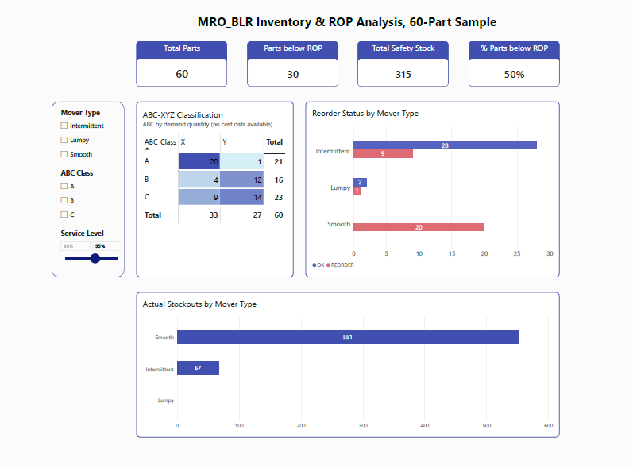

# Inventory Planning & ROP Optimization: Aviation Spare Parts

Excel + Power Query + Power BI analysis that classifies spare parts by demand pattern, forecasts each class with a suitable method, and calculates safety stock and reorder points (ROP) driven by a service-level slider.

## Data
[Synthetic Aviation Spare Parts dataset (Zenodo)](https://zenodo.org/records/20551017): one location (MRO_BLR), 60 parts, 72 months. The data is synthetic, so results demonstrate the method, not real-world behaviour.

## Method
1. **Classification:** ADI and CV² with Syntetos-Boylan-Croston thresholds (1.32 / 0.49) → Smooth, Erratic, Intermittent, Lumpy. ABC by quantity, XYZ by CV.
2. **Forecasting:** 6-month moving average (Smooth), recursive Croston (Intermittent), Croston with SBA correction (Lumpy/Erratic).
3. **Safety stock and ROP:** combined demand and lead-time variability, Z-score from a 90–99% service-level slider (default 95%).
4. **Dashboard:** KPI cards, ABC-XYZ matrix, reorder status and stockouts by mover type.

## Results (95% service level)
37 Intermittent, 20 Smooth, 3 Lumpy, 0 Erratic. Total safety stock about 315 units. 30 of 60 parts are below ROP.

## Limitations
Synthetic data; ABC is quantity-based (no cost field); moving average stands in for SES; no Erratic or Z-class parts in this sample; one flat service level. Full notes are in `docs/`.

## Files
- excel/Analysis.xlsx: formulas for classification, forecasts, safety stock and ROP
- `powerbi/Analysis_ROP.pbix`: model, DAX measures, dashboard
- `docs/`: methodology notes
